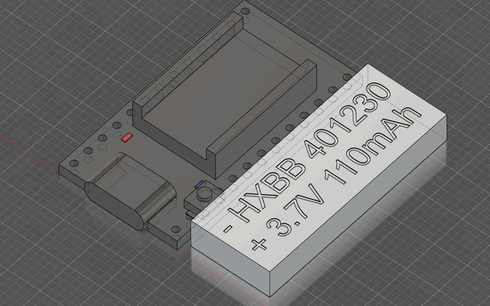

# SlimeVR-Smol-Tracker-Internal-Components-Models

## Model
This repo contains model with
- nRF52840 board in stacked layout. 
  with:
   - Button 3x4x2mm
   - IMU modeled after ICM-45686 with tolerance extrusions
- Battery in form factor 401230  

## Autodesk Fusion
- Models made in Autodesk Fusion.
- Autodesk Fusion is free for personal use.
- Use `Insert Derive` in Autodesk Fusion, to insert parts in your project for further use:
   